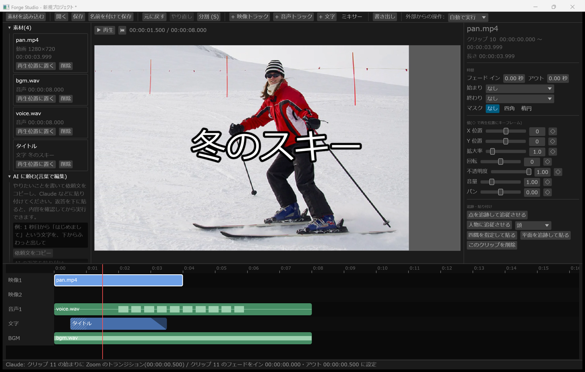
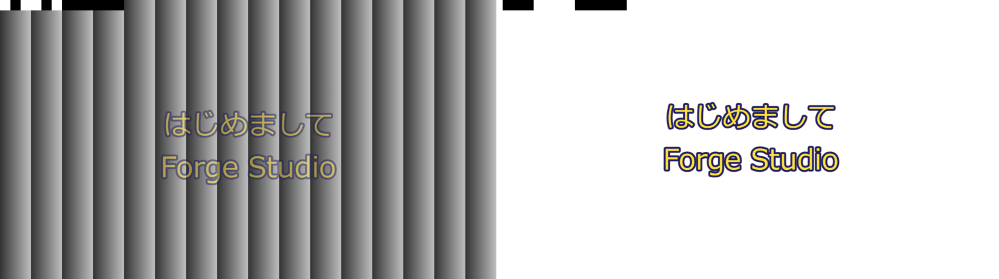
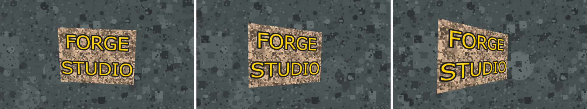
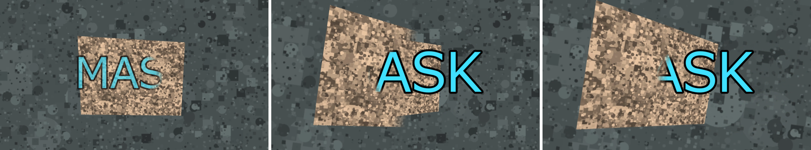
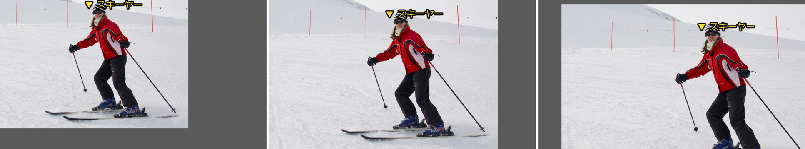
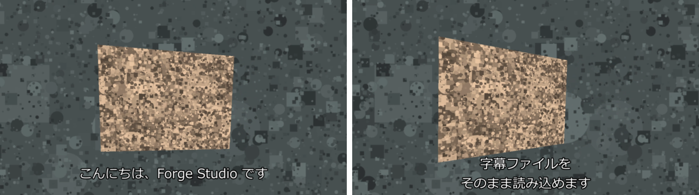
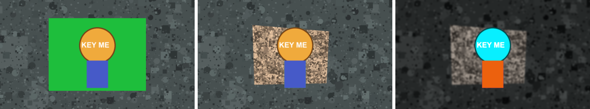
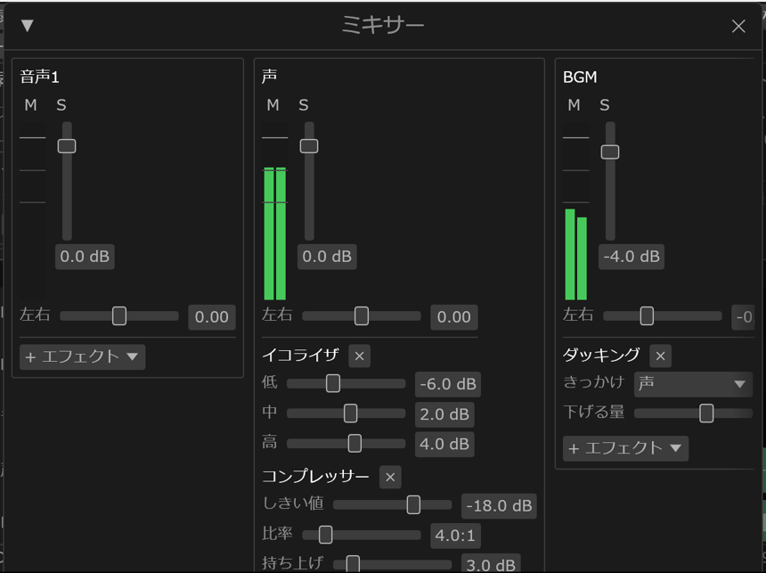
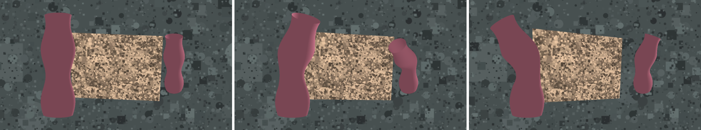

# Forge Studio(本体)

AviUtl2 のような動画編集ソフト。Rust + Direct3D 11 + egui + Media Foundation。

## 現在できること(Phase 1)

- 動画・音声・画像の読み込み(ファイル選択、またはウィンドウへのドロップ)
- タイムライン: トラックの追加、クリップの配置・移動(トラック間も)・端のドラッグで長さ変更・分割・削除、スナップ
- 位置・拡大率・回転・不透明度・音量・パンの調整と、キーフレーム
- プレビュー再生(音声デバイスの時計に映像を合わせる)、コマ送り
- Undo / Redo(全操作)、プロジェクトの保存・読み込み(`.fsproj`、JSON)
- MP4(H.264 + AAC)への書き出し(別スレッド、進捗表示・中止)
- **文字**: 「+ 文字」で追加。内容・フォント・大きさ・色・縁取り・揃えを調整欄で編集(連続した入力は 1 回の Ctrl+Z で戻る)
- **フェードイン・アウト**: クリップごとに秒で指定。映像は不透明度、音声は音量に効く。タイムラインに三角形で表示
- **音声の波形**: 音声クリップに表示(音量・フェードを反映)
- **AI に頼む(言葉で編集)**: やりたいことを書いて「依頼文をコピー」→ Claude などに貼る → 返答を貼って「取り込む」→
  変更内容を確認して「実行する」。失敗したら「修正依頼をコピー」。API の費用はかからない
- **点トラッキングによる追従**: クリップを選んで「点を追跡して追従させる」を押し、下の動画の追いたい点をプレビューでクリックすると、
  再生位置からクリップの終わりまで点を追い、x / y のキーフレームとして追従させる(1 回の Ctrl+Z で取り消せる)。
  平らな場所をクリックしても、近くの模様のはっきりした点に吸着する。見失ったらそこで止める
- **人物の追従**: クリップを選んで部位(頭・首元・胴体の中心・腰・左右の手・左右の足)を選び、「人物に追従させる」を押して
  下の動画の人物をクリックすると、その人の部位の動きに合わせてクリップが動く(x / y のキーフレーム)。複数人いても選んだ人を追い続け、
  一瞬隠れても数フレームは続ける。端末内で推定し、外部へは何も送らない(モデルの準備が必要。下の「人物の推定モデル」)
- **四隅の貼り付け(コーナーピン)**: 「四隅を指定して貼る」でプレビューを 左上→右上→右下→左下 とクリックすると、
  クリップの素材をその四角形に遠近つきで合わせる。四隅はキーフレームにでき、キーの間は直線で補間する
- **プロキシ(長い動画・高解像度の動画の軽量表示)**: プレビュー用に、高さ 540・0.2 秒ごとにキーフレームの軽い動画を別に作り、
  上の「軽量表示」がオンのときプレビューだけそれを使う(書き出しは常に元の動画)。1080p を超える動画か 2 分を超える動画は読み込むと自動で作り、
  ほかは素材の欄の「プロキシを作る」で作る。置き場所は `%LOCALAPPDATA%\ForgeStudio\proxies`(元の動画を差し替えると作り直し)。
  テストでは 1280×720・10 秒の動画で、飛び飛びのシークが 1 回 約 660ms → 約 80ms になった。
  書き出す動画も 2 秒ごとにキーフレームを入れるようにした(書き出した動画を再び編集するときにシークが速い)
- **トランジション**: クリップの「始まり」「終わり」それぞれに、フェード・ワイプ(4 方向)・円形・スライド(4 方向)・ズームを秒で指定。
  始まりのトランジションの間は、同じトラックですぐ前に接しているクリップが下に表示され続けるので、
  フェードならクロスフェード、ワイプなら前の映像を拭うように切り替わる(前のクリップの素材が足りなければ最後のフレームで止める)
- **画面の大きさ・フレームレート**: 何も選んでいないときの調整欄で選ぶ(横 1920×1080・1280×720・4K、縦 1080×1920(ショート・リール)・720×1280、
  正方形、4:5。フレームレートは 23.976〜60)。1 回の Ctrl+Z で戻る
- **コマの補間(フレームブレンド)**: プロジェクトの設定(何も選んでいないときの調整欄)でオンにすると、素材の 1 コマが
  プロジェクトの 1 コマより長く映るとき(24fps の素材を 60fps で使う、スロー再生など)、前後のコマを時刻に応じた割合で混ぜる。
  逆再生でも次に映るコマを混ぜる
- **字幕(SRT・WebVTT)**: 上の「字幕」から字幕ファイルを読み込むと、新しいトラックに下寄せの文字のクリップとして並ぶ
  (白文字に黒の縁取り、大きさは画面の高さに合わせる。時間が重なる字幕は別のトラック。1 回の Ctrl+Z で全部戻る)。
  文字のクリップを SRT で書き出すこともできる(文字のクリップを選んでいれば、そのトラックだけ)。MCP では `import_subtitles` / `get_subtitles`
- **映像と音声のリンク**: 音声つきの動画を「再生位置に置く」と、映像と音声のクリップがリンクされ、移動・分割・削除と、
  時間がそろっているときの端の伸縮・速度・逆再生が両方に効く(1 回の Ctrl+Z で両方戻る)。ドラッグ中も一緒に動いて見える。
  調整欄の「リンクを外す」で別々に動かせる
- **速度の変更**: 調整欄の「速度」で 0.1〜10 倍(0.5 倍・1 倍・2 倍のボタンもある)。同じ素材の範囲を使うので、2 倍なら長さが半分になり、
  キーフレーム・フェード・トランジションの時刻も合わせて伸び縮みする(後ろのクリップと重なる場合は変えない)。
  タイムラインのクリップに「×2」のように表示する。音声は、速度を変えても高さを保つ(約 21ms の粒を、前の粒と波形が合う所で
  つなぎ直す WSOLA 方式。テストでは 0.5・1.5・2 倍で 440Hz の高さの誤差 1% 以内)。「音の高さを保つ」を外すと、
  テープの早回しのように高さも変わる
- **逆再生**: 速度の横の「逆再生」で、素材の同じ範囲を終わりから始まりへ再生する(音声も逆になる。速度と組み合わせられる)。
  タイムラインには「◀」と表示し、端のドラッグは逆向きの素材の範囲に合わせて伸び縮みする。
  後ろ向きに読むときは、シークで読んだフレームを覚えておいて使い回す(640×360 の動画で 1 フレーム約 6ms)
- **色の調整・ぼかし・クロマキー**: 調整欄の「色・ぼかし・クロマキー」で、明るさ・コントラスト・彩度・色相・ぼかし(半径ピクセル)を
  クリップごとに変えられる(キーフレーム可)。クロマキーは「スポイト」でプレビューの緑などをクリックすると、その色に近い所を透明にする
  (範囲・境目のなめらかさ・縁の色かぶりの除去を調整できる。スポイトは色の調整を外した元の色を取る)。どれも GPU のシェーダで処理する
- **マスク**: 四角・楕円、反転、ぼかし。位置・大きさ・ぼかしはキーフレームで動かせる(四隅の貼り付けや 3D モデルにも効く)
- **ミキサー**: 上の「ミキサー」で開く。音声トラックごとに音量(dB)・左右のバランス・消音(M)・ソロ(S)と、再生中の音量メーター。
  全体の音量とピーク表示(0dB を超えると「音割れ」)。スライダーの連続した操作は 1 回の Ctrl+Z で戻る
- **音声エフェクト**(トラックごと、上から順にかかる): イコライザ(低 200Hz・中 1kHz・高 5kHz)、コンプレッサー、
  ダッキング(声など別のトラックに音がある間だけ BGM を下げる。きっかけのトラックは消音していても使える)
- **3D モデル(glTF / GLB / VRM)**: 動画や画像と同じように読み込んで置ける。位置・拡大・回転・不透明度・四隅の貼り付けは画像と同じで、
  「3D 横の向き」「3D 縦の傾き」で立体的に向きを変えられる(キーフレーム可)。骨の動き(スキニング)とアニメーションは繰り返し再生する。
  色は基本色と基本色の画像を使う(陰影は簡易的な光 1 つ)
- **平面トラッキング**: 「平面を追跡して貼る」で下の動画の壁・机・看板などの四隅をクリックすると、平面の中の多数の点を追い、
  射影変換(RANSAC)で四隅を動かして、クリップを遠近ごと貼り付け続ける。手前を物が横切っても残りの点で推定を続ける



文字とフェード(左: フェードイン中で下から上がってくる途中、右: 表示しきった状態)と、タイムラインの波形・フェード表示:



トラッキングの確認(模様が右上へ流れる動画。赤い点を模様に追従させた 0.5 秒目と 3.4 秒目):


精度: 動きが分かっている動画(H.264)で、60 フレームの最大誤差 0.02px(テスト)、
1280×720 の動画で 90 フレーム後の誤差 1px 未満(MCP 経由の実機確認)。

平面トラッキングの確認(遠近を変えながら動く板に、文字のクリップを貼り付けた 0 秒目・2 秒目・4 秒目。MCP の `track_plane` で実行):


精度: 平行移動する動画で四隅の最大誤差 0.04px(テスト)、遠近が変わる 1280×720 の動画で 120 フレーム後の四隅の誤差 1.5px 未満。

トランジションとマスク(動画を 2 秒で分割し、後半の始まりに左→右のワイプ。文字には楕円のマスクを付け、左から右へ動かした。0.5 秒・2.5 秒・3.5 秒):


人物の追従(写真を拡大しながら動かした動画で、名札の文字を頭に追従させた。0 秒・1.5 秒・3.5 秒):


精度: 横に動く動画で、頭・胴体の位置のずれは最大 3px 程度(テスト)。速さは 1 フレーム約 36ms(CPU)。

字幕ファイルの読み込み(1 秒目と 3 秒目。2 つ目は 2 行の字幕):


色の調整とクロマキー(左: 元の合成、中: 緑をクロマキーで抜いた、右: 背景をぼかして彩度と明るさを下げ、手前の色相を 150 度回した。MCP で実行):


ミキサー(再生中。声に EQ とコンプレッサー、BGM に声をきっかけにしたダッキング):


3D モデルの確認(骨で曲がるアニメーション付きのモデルを 2 つ置き、左は 0〜3 秒で横に 180 度回し、右は小さくして傾けた。0 秒・0.5 秒・1.5 秒):


## Claude から操作する(MCP)

Forge Studio は、起動中に Claude(Claude Code / Claude Desktop)から操作できる。
API の従量課金は不要で、手持ちの Claude から使える。

- アプリは 127.0.0.1(この PC の中だけ)で待ち受け、起動ごとに作る合言葉が一致しない要求は受け付けない
- アプリ上部の「外部からの操作」で、権限を「閲覧のみ / 編集は確認する(既定)/ 自動で実行」から選ぶ
- 「編集は確認する」では、Claude の編集のたびに内容が表示され、承認してから実行される
- 動画の書き出し(ファイルを書く操作)は、設定に関わらず必ず確認する
- Claude の操作は操作履歴に記録され、Ctrl+Z で 1 回ずつ取り消せる

### つなぎ方

Claude Code:

```
claude mcp add forge-studio -- "C:\path\to\forge-studio-mcp.exe"
```

Claude Desktop(`claude_desktop_config.json`):

```json
{ "mcpServers": { "forge-studio": { "command": "C:\\path\\to\\forge-studio-mcp.exe" } } }
```

先に Forge Studio を起動しておく。Claude に「プロジェクトを見て、キャラ画像を 1 秒目から右から登場させて」のように頼む。

### 使えるツール

| ツール | 内容 |
|---|---|
| `get_project` | 素材・トラック・クリップ(ID・時刻・値・キーフレーム)の要約 |
| `get_state` | 再生位置・選択中のクリップ・未保存の変更・権限、再生中ならトラックごとと全体の音量(dB) |
| `get_command_schema` | 編集コマンドの書式と例 |
| `execute_commands` | 編集コマンドの配列を 1 つの操作として実行(`dry_run` で試し実行) |
| `import_file` | この PC のファイル(動画・音声・画像・3D モデル)を素材として読み込む |
| `import_subtitles` / `get_subtitles` | 字幕ファイル(SRT・VTT)を文字のクリップとして置く / 文字のクリップを SRT で返す |
| `render_frame` | 任意の時刻の画面を画像で返す |
| `seek` / `play` / `stop` / `undo` / `redo` | 再生位置・再生・取り消し |
| `export_video` / `export_status` | MP4 に書き出す(必ず承認が必要) |
| `track_follow` / `track_status` | クリップを、下の動画上の点の動きに追従させる(画面上の位置で点を指定) |
| `track_person` | クリップを、下の動画に写っている人物の部位(頭・手など)の動きに追従させる |
| `track_plane` | クリップを、下の動画に写っている平面(四隅で指定)に貼り付け、平面を追跡して動かす |

## 操作

| キー | 動作 |
|---|---|
| Space | 再生 / 停止 |
| ← → | 1 フレーム移動 |
| Home | 先頭へ |
| S | 再生位置で分割(選択中のクリップ、無ければ再生位置の全クリップ) |
| Delete | 選択中のクリップを削除 |
| Ctrl+Z / Ctrl+Y | 元に戻す / やり直し |
| Ctrl+S | 保存 |
| Ctrl+ホイール | タイムラインの拡大縮小 |

起動時にファイルを渡すと読み込んで並べる: `forge-studio.exe 動画.mp4 画像.png`(`.fsproj` なら開く)。

## 構成

| クレート | 役割 |
|---|---|
| `studio-core` | 時間・プロジェクト・コマンド・Undo/Redo・評価(UI/GPU/OS に依存しない) |
| `studio-media` | Media Foundation での読み込み・シーク・音声取得・書き出し |
| `studio-render` | D3D11 での合成、音声ミックス、書き出しの処理 |
| `studio-app` | アプリ本体(ウィンドウ、UI、タイムライン、再生エンジン、外部操作の受付口) |
| `studio-track` | 点・平面トラッキング(ピラミッド Lucas-Kanade、往復チェック、見失いの検出、RANSAC 射影変換)と、追従・四隅のキーフレーム作成 |
| `studio-pose` | 人物の検出と姿勢推定(ONNX Runtime、CPU)、人物の追跡、部位の位置の取り出し |
| `studio-mcp` | Claude が起動する MCP サーバー(`forge-studio-mcp.exe`)。アプリの受付口へ取り次ぐ |

## ビルドとテスト

```
cargo test
cargo build --release -p studio-app
```

フォルダのパスが長いとリンクに失敗する(LNK1104)ので、`CARGO_TARGET_DIR` に短いパスを指定する。

## 人物の推定モデル

人物の追従には、OpenMMLab の 2 つのモデル(ONNX 形式)が必要。アプリには含めていない。

```
%LOCALAPPDATA%\ForgeStudio\models\rtmdet\end2end.onnx    人物の検出(RTMDet-nano、約 4MB)
%LOCALAPPDATA%\ForgeStudio\models\rtmpose\end2end.onnx   関節の推定(RTMPose-m、約 52MB)
```

場所は環境変数 `STUDIO_POSE_MODELS` で変えられる。入手先は MMPose の RTMPose の配布ページ(ONNX の SDK 版)。

**注意(利用条件)**: コードは Apache-2.0 だが、RTMPose-m(body7)の学習済み重みは、学習に使ったデータの条件を引き継ぐ可能性がある。
動画を公開・商用で使う前に確認すること。代わりに COCO だけで学習した重みも使える(入出力の形式が同じもの)。

テスト(`studio-pose`)は、モデルと人物の写真(環境変数 `STUDIO_POSE_IMAGE`)があるときだけ動く。

## 既知の問題

- プレビューの映像は CPU 経由で転送している(GPU 上での受け渡しは今後)
- 素材のフレームレートがプロジェクトより低いときやスローのとき、既定では最も近いフレームを表示する
  (プロジェクトの「コマの補間(フレームブレンド)」をオンにすると前後のコマを混ぜる。動きの推定による補間は未対応)
