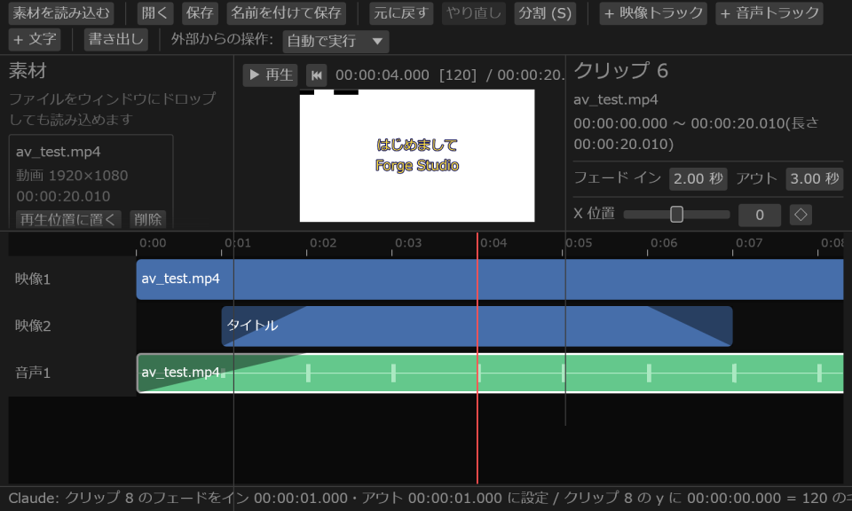
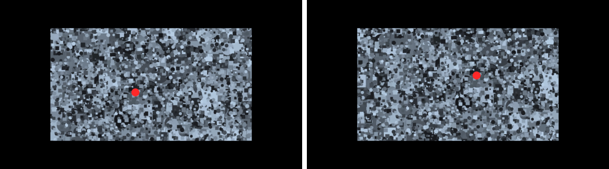

# Forge Studio(本体)

AviUtl2 のような動画編集ソフト。Rust + Direct3D 11 + egui + Media Foundation。

## 現在できること(Phase 1)

- 動画・音声・画像の読み込み(ファイル選択、またはウィンドウへのドロップ)
- タイムライン: トラックの追加、クリップの配置・移動(トラック間も)・端のドラッグで長さ変更・分割・削除、スナップ
- 位置・拡大率・回転・不透明度・音量・パンの調整と、キーフレーム
- プレビュー再生(音声デバイスの時計に映像を合わせる)、コマ送り
- Undo / Redo(全操作)、プロジェクトの保存・読み込み(`.fsproj`、JSON)
- MP4(H.264 + AAC)への書き出し(別スレッド、進捗表示・中止)
- **文字**: 「+ 文字」で追加。内容・フォント・大きさ・色・縁取り・揃えを調整欄で編集(連続した入力は 1 回の Ctrl+Z で戻る)
- **フェードイン・アウト**: クリップごとに秒で指定。映像は不透明度、音声は音量に効く。タイムラインに三角形で表示
- **音声の波形**: 音声クリップに表示(音量・フェードを反映)
- **AI に頼む(言葉で編集)**: やりたいことを書いて「依頼文をコピー」→ Claude などに貼る → 返答を貼って「取り込む」→
  変更内容を確認して「実行する」。失敗したら「修正依頼をコピー」。API の費用はかからない
- **点トラッキングによる追従**: クリップを選んで「点を追跡して追従させる」を押し、下の動画の追いたい点をプレビューでクリックすると、
  再生位置からクリップの終わりまで点を追い、x / y のキーフレームとして追従させる(1 回の Ctrl+Z で取り消せる)。
  平らな場所をクリックしても、近くの模様のはっきりした点に吸着する。見失ったらそこで止める


文字とフェード(左: フェードイン中で下から上がってくる途中、右: 表示しきった状態)と、タイムラインの波形・フェード表示:



トラッキングの確認(模様が右上へ流れる動画。赤い点を模様に追従させた 0.5 秒目と 3.4 秒目):


精度: 動きが分かっている動画(H.264)で、60 フレームの最大誤差 0.02px(テスト)、
1280×720 の動画で 90 フレーム後の誤差 1px 未満(MCP 経由の実機確認)。

## Claude から操作する(MCP)

Forge Studio は、起動中に Claude(Claude Code / Claude Desktop)から操作できる。
API の従量課金は不要で、手持ちの Claude から使える。

- アプリは 127.0.0.1(この PC の中だけ)で待ち受け、起動ごとに作る合言葉が一致しない要求は受け付けない
- アプリ上部の「外部からの操作」で、権限を「閲覧のみ / 編集は確認する(既定)/ 自動で実行」から選ぶ
- 「編集は確認する」では、Claude の編集のたびに内容が表示され、承認してから実行される
- 動画の書き出し(ファイルを書く操作)は、設定に関わらず必ず確認する
- Claude の操作は操作履歴に記録され、Ctrl+Z で 1 回ずつ取り消せる

### つなぎ方

Claude Code:

```
claude mcp add forge-studio -- "C:\path\to\forge-studio-mcp.exe"
```

Claude Desktop(`claude_desktop_config.json`):

```json
{ "mcpServers": { "forge-studio": { "command": "C:\\path\\to\\forge-studio-mcp.exe" } } }
```

先に Forge Studio を起動しておく。Claude に「プロジェクトを見て、キャラ画像を 1 秒目から右から登場させて」のように頼む。

### 使えるツール

| ツール | 内容 |
|---|---|
| `get_project` | 素材・トラック・クリップ(ID・時刻・値・キーフレーム)の要約 |
| `get_state` | 再生位置・選択中のクリップ・未保存の変更・権限 |
| `get_command_schema` | 編集コマンドの書式と例 |
| `execute_commands` | 編集コマンドの配列を 1 つの操作として実行(`dry_run` で試し実行) |
| `import_file` | この PC のファイルを素材として読み込む |
| `render_frame` | 任意の時刻の画面を画像で返す |
| `seek` / `play` / `stop` / `undo` / `redo` | 再生位置・再生・取り消し |
| `export_video` / `export_status` | MP4 に書き出す(必ず承認が必要) |
| `track_follow` / `track_status` | クリップを、下の動画上の点の動きに追従させる(画面上の位置で点を指定) |

## 操作

| キー | 動作 |
|---|---|
| Space | 再生 / 停止 |
| ← → | 1 フレーム移動 |
| Home | 先頭へ |
| S | 再生位置で分割(選択中のクリップ、無ければ再生位置の全クリップ) |
| Delete | 選択中のクリップを削除 |
| Ctrl+Z / Ctrl+Y | 元に戻す / やり直し |
| Ctrl+S | 保存 |
| Ctrl+ホイール | タイムラインの拡大縮小 |

起動時にファイルを渡すと読み込んで並べる: `forge-studio.exe 動画.mp4 画像.png`(`.fsproj` なら開く)。

## 構成

| クレート | 役割 |
|---|---|
| `studio-core` | 時間・プロジェクト・コマンド・Undo/Redo・評価(UI/GPU/OS に依存しない) |
| `studio-media` | Media Foundation での読み込み・シーク・音声取得・書き出し |
| `studio-render` | D3D11 での合成、音声ミックス、書き出しの処理 |
| `studio-app` | アプリ本体(ウィンドウ、UI、タイムライン、再生エンジン、外部操作の受付口) |
| `studio-track` | 点トラッキング(ピラミッド Lucas-Kanade、往復チェック、見失いの検出)と、追従のキーフレーム作成 |
| `studio-mcp` | Claude が起動する MCP サーバー(`forge-studio-mcp.exe`)。アプリの受付口へ取り次ぐ |

## ビルドとテスト

```
cargo test
cargo build --release -p studio-app
```

フォルダのパスが長いとリンクに失敗する(LNK1104)ので、`CARGO_TARGET_DIR` に短いパスを指定する。

## 既知の問題

- 右側パネルの境界線が、タイムラインの上に重なって描かれる(見た目のみ)
- プレビューの映像は CPU 経由で転送している(GPU 上での受け渡しは今後)
- 素材のフレームレートとプロジェクトのフレームレートが違うときの補間は未対応(最も近いフレームを表示)
